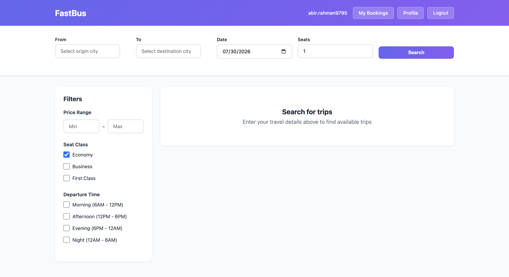
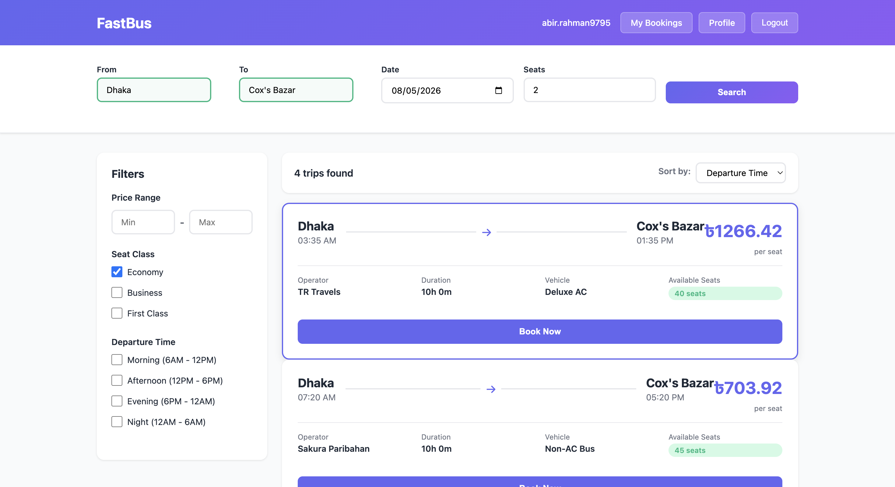
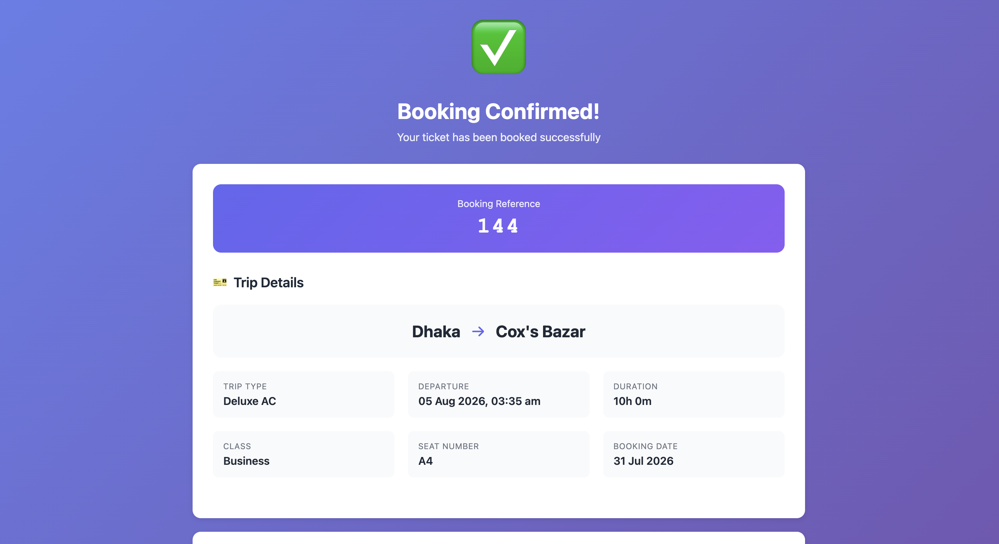
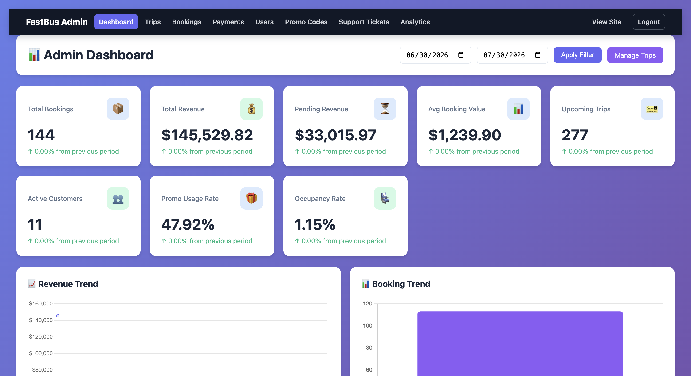
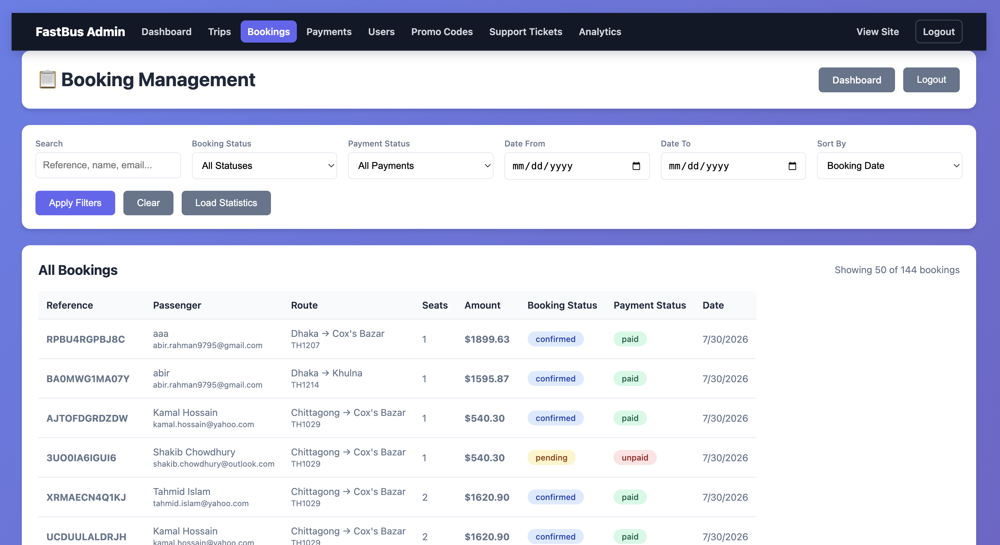

# FastBus

FastBus is a full-stack bus ticket booking demo built with Flask, PostgreSQL,
SQLAlchemy, JWT authentication, and a vanilla JavaScript frontend. It models
Bangladesh routes, operators, bookings, promotions, support tickets, mock
payments, and administrative reporting.

> FastBus is a portfolio/demo application. Payments are simulated and no real
> money is processed.

## Screenshots

### Home



### Trip Search



### Booking Confirmation



### Admin Dashboard



### Booking Management



## Highlights

- Trip search with live seat availability and seat classes
- Customer booking, cancellation, profile, payment history, and support tickets
- JWT access and refresh tokens plus optional Google sign-in
- Role-protected admin dashboards for trips, users, bookings, promotions,
  payments, tickets, and analytics
- PostgreSQL migrations and realistic Bangladesh-focused seed data
- Docker Compose health checks and automated startup migrations
- Pytest API tests and GitHub Actions CI

## Architecture

```text
Browser
   |
   | HTML/CSS/JavaScript + JSON API
   v
Flask / Gunicorn
   |
   | SQLAlchemy + Alembic migrations
   v
PostgreSQL
```

The Flask application serves both the frontend and the `/api` routes, so a
separate frontend server is not required.

## Quick start

Requirements:

- Docker Desktop
- Docker Compose v2

Create the local environment file:

```bash
cp .env.example .env
```

Generate and place unique development secrets in `.env`:

```bash
python3 -c "import secrets; print(secrets.token_hex(32))"
```

Start the application:

```bash
docker compose up --build -d
docker compose logs -f api
```

Open <http://localhost:5000>. The health endpoint is available at
<http://localhost:5000/api/auth/health>.

On macOS, AirPlay Receiver may occupy port 5000. Either disable AirPlay
Receiver or set `APP_PORT=5001` in `.env`, restart Compose, and open
<http://localhost:5001>.

## Demo data

Set this in `.env` before the first startup:

```env
SEED_DATABASE=true
```

The seed task creates fictional users, trips, bookings, promotions, mock
payments, and support tickets. Seeded credentials are deliberately predictable
and must never be enabled in a public or production deployment.

To seed manually:

```bash
docker compose exec api python seed_db.py
```

The seed script recreates application tables and is destructive to existing
local data.

## Local development and tests

Create a virtual environment and install dependencies:

```bash
python3 -m venv .venv
source .venv/bin/activate
pip install -r requirements.txt -r requirements-dev.txt
pytest --cov=app --cov-report=term-missing
```

Useful Docker commands:

```bash
make up
make logs
make migrate
make seed
make down
```

Optional pgAdmin:

```bash
docker compose --profile tools up -d
```

Then open <http://localhost:5050>.

## API overview

| Area | Base path |
|---|---|
| Authentication | `/api/auth` |
| Trips and fares | `/api/trips` |
| Bookings | `/api/bookings` |
| Mock payments | `/api/payments` |
| Profiles | `/api/profile` |
| Support tickets | `/api/tickets` |
| Administration | `/api/admin` |

A Postman collection is included in
[`TicketHub.postman_collection.json`](TicketHub.postman_collection.json).

## Security design

- Public signup always creates customer accounts.
- Administrative routes verify the user role server-side.
- Booking ownership is checked for customer operations.
- Selected seat rows are locked during booking to prevent concurrent
  double-booking on PostgreSQL.
- Payment details are masked, and payment processing is explicitly simulated.
- Internal exception details are not returned in API responses.
- `.env` and local database files are excluded from Git.

For an internet-facing deployment, add managed secrets, HTTPS, rate limiting,
token revocation, security headers, centralized logging, monitoring, and a real
payment provider.

## Project structure

```text
app/
  models/       SQLAlchemy domain models
  routes/       Customer and administrator API blueprints
  utils/        Validation, JWT, authorization, and error helpers
frontend/       Self-contained HTML/CSS/JavaScript pages
migrations/     Alembic database migrations
tests/          Pytest API tests
```

## License

[MIT](LICENSE)
